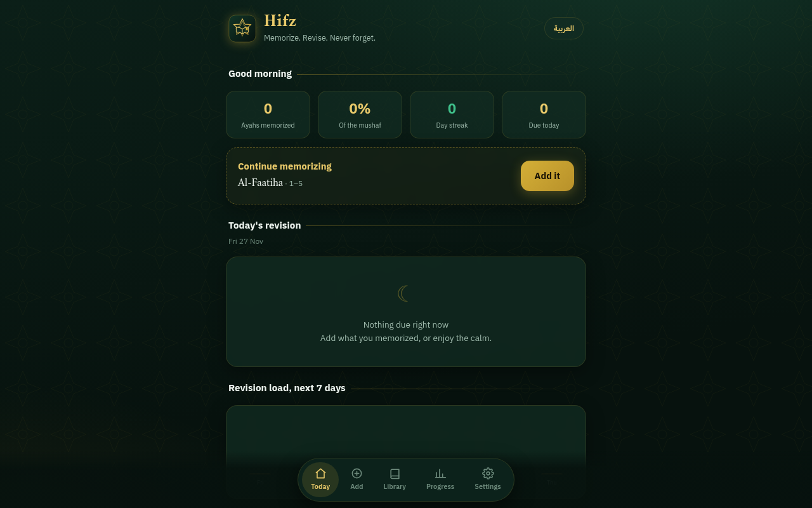
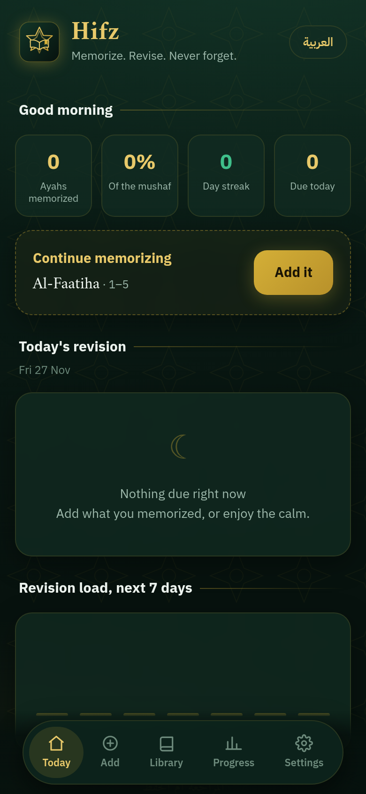
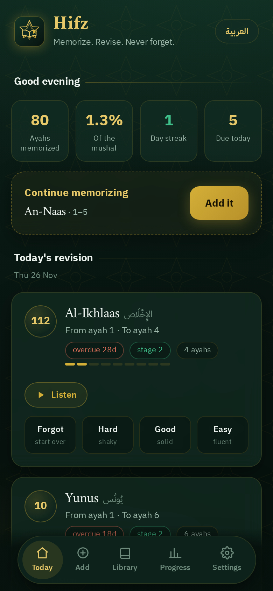
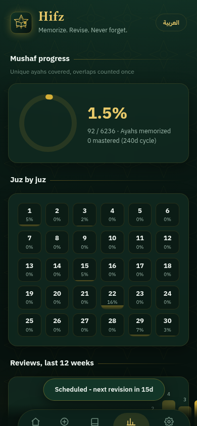
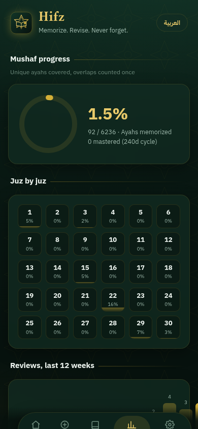
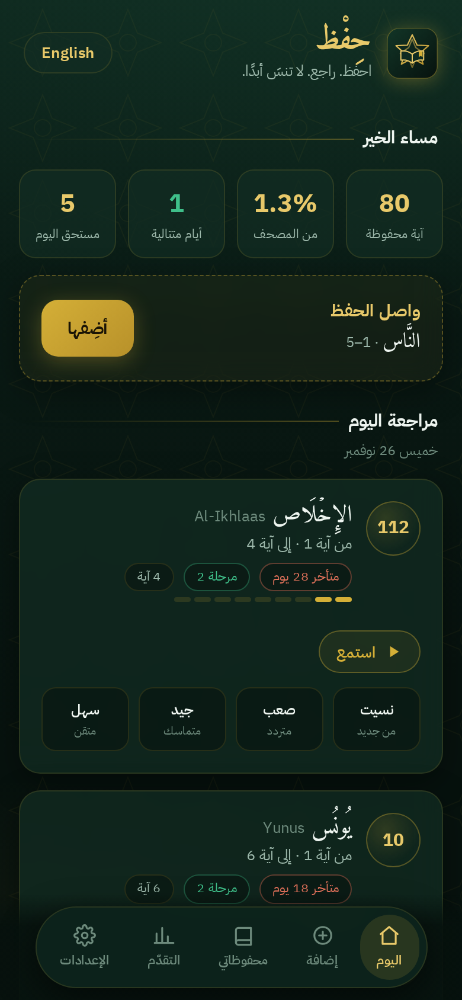

# Hifz · حِفْظ

**Hifz is a private Quran memorization tracker with spaced-revision scheduling.**
Log what you memorized (surah and ayah range), and Hifz builds your revision
calendar: fresh portions come back quickly, strong ones space out, and anything
you forget returns to the start of the ladder.

**Live demo:** https://yousefkhames.github.io/hifz/

## Screenshots

Captured from the live site (https://yousefkhames.github.io/hifz/).

  
  

## Why

Memorization without revision evaporates. Most trackers are either plain
checklists or full mushaf readers. Hifz does one thing: it remembers *what* you
memorized and tells you *when* to revise it, in Arabic or English, on your
phone, without an account.

## Features

- **Log memorizations** - pick any of the 114 surahs from a searchable picker,
  enter the ayah range, the date, and how strong it feels. Ranges are validated
  against the real ayah count of each surah.
- **Spaced-revision engine** - a 9-rung interval ladder (1, 2, 4, 7, 15, 30, 60,
  120, 240 days). Grade each revision *Forgot / Hard / Good / Easy* and the
  schedule adapts: forgetting resets the rung, fluency skips ahead.
- **Today view** - everything due right now, most overdue first, with a 7-day
  forecast of the revision load ahead.
- **Progress** - unique-ayah coverage of the whole mushaf (overlapping ranges
  merged, never double-counted), a 30-juz coverage grid, per-surah bars, and a
  12-week review activity chart.
- **Continue-memorizing suggestion** - picks up right after the furthest ayah
  you have logged, sized to your daily target.
- **Streaks** - consecutive revision days; a streak survives until you finish
  today's reviews.
- **Arabic & English** - full UI translation with proper RTL layout, Amiri for
  surah names.
- **Listen** - every portion has a Listen button that plays the ayahs of your
  range one after another, so you can check how a verse is pronounced. Choose
  from six reciters in Settings (Alafasy, Al-Husary, Al-Minshawi, Abdul Basit,
  As-Sudais, Ash-Shuraim). Audio streams from [everyayah.com](https://everyayah.com).
- **Works offline and installs** - the app, its fonts and icons are cached after
  the first visit and the app can be added to the home screen. Listening needs
  a connection.
- **Private by design** - everything lives in `localStorage`. Export/import
  JSON to move between browsers.

## Screenshots

| Today | Add | Progress | Arabic (RTL) |
| --- | --- | --- | --- |
|  |  |  |  |

Screenshots are from the app with clean sample data.

## Data accuracy

- Ayah counts for all 114 surahs are bundled in `data.js` and were
  cross-verified against two independent sources that agree on every surah:
  [api.alquran.cloud](https://api.alquran.cloud/v1/surah) (Tanzil data) and
  [api.quran.com](https://api.quran.com/api/v4/chapters). Total: 6,236 ayahs.
- Juz boundaries verified contiguous against
  [api.quran.com/api/v4/juzs](https://api.quran.com/api/v4/juzs) (1:1 through
  114:6).
- **No Quran text is stored or displayed anywhere in this app** - only surah
  names, ayah counts, and the ranges you log.

## Tech

- Vanilla HTML/CSS/JS. No frameworks, no build step, no dependencies at
  runtime. Fonts (Amiri, IBM Plex Sans Arabic, SIL OFL) are bundled in `fonts/`.
  A service worker caches the app for offline use.
- `scheduler.js` is pure, DOM-free logic shared verbatim between the browser
  and the test suite.
- Tests: `npm test` runs `tests/test.js` (425+ assertions over the scheduler
  and the bundled mushaf data, zero dependencies) and `tests/dom.test.js` (a
  jsdom click-through of the real UI: add, review, listen, search spellings, filter, delete, import,
  language switch). Only dev dependency is jsdom, for the DOM test.
- Hosted as a static site on GitHub Pages.

## Honest limits

- This is a **demo host**: GitHub Pages serves the static files, nothing more.
- **Your data is per browser** (localStorage). Clearing site data erases it;
  use Settings → Export to back up or move devices.
- The schedule is a heuristic ladder, not a full SM-2 implementation.
- Offline works after the first visit. **Recitation audio is not cached and
  not bundled**: it streams from everyayah.com, so Listen needs a connection and
  everyayah.com can see which ayahs you play (nothing else about you). The
  recitation is a third party recording, not made by this project.
- Listen plays the ayahs you logged; it does not show the Quran text. Use a
  mushaf next to it.
- The surah picker accepts common Latin spellings (Yasin, Baqarah, Kahf) but
  the names follow the Tanzil transliteration (for example, Yaseen).

## License

MIT - see [LICENSE](LICENSE).

## Demo / portfolio project

Static GitHub Pages site. Data stays in your browser. Sample data is fictional and results are not professional, legal, medical or financial advice.

By Yousef Khames · من تطوير يوسف خميس
